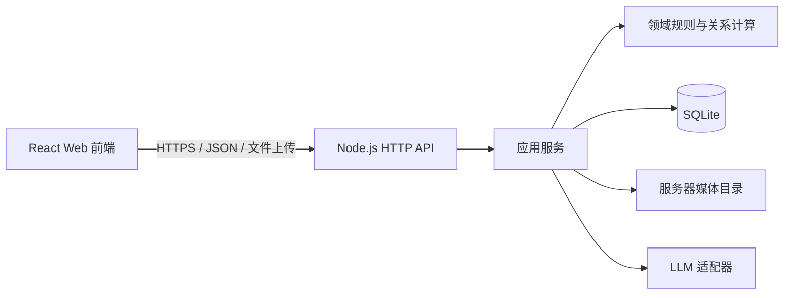

# 家谱智能体 Web MVP 产品与技术设计

日期：2026-10-01

状态：待用户书面复核

适用规模：单一家族、100–1000 人

## 1. 目标与成功标准

本产品是一个以人物关系图谱为事实底座、以 LLM 负责自然语言理解与表达的家谱智能体。管理员可以通过表单、中文 Excel 和对话录入人物及关系；系统经过结构化预览、规则校验和人工确认后写入数据。用户能够切换观察视角浏览家谱树，并询问人物资料、亲属关系和人数统计。

首版成功标准：

- 管理员能够从零建立或通过 Excel 导入一个 100–1000 人的家谱。
- 任一写入都先预览、再校验、后确认，并能够在安全条件满足时撤销。
- 家谱树能明确区分本层子女与其配偶，正确展示离婚、再婚及各段婚姻对应的子女。
- 任意两名已连通人物之间可以计算关系路径，并据当前视角给出称谓。
- 问答只使用家谱中的可核对事实；同名时先确认人物，信息不足时明确回答“未知”，不把未知当作零。
- MVP 以网页运行，不依赖 Electron 安装包，不要求离线可用。

## 2. MVP 边界

### 2.1 包含范围

- 单一家族、单管理员。
- 人物资料：姓名、性别、出生日期、备注、代际、字辈、家族归属、照片和声音。
- 关系：生父、生母、子女、婚姻、离婚、再婚。
- 录入：人物表单、近亲属向导、中文 Excel、对话式录入。
- 查询：人物资料、直接亲属、任意两人的关系路径与相互称谓、基础人数统计。
- 展示：完整家谱、分支、祖先、后代视图；观察视角切换；人物详情。
- 数据治理：冲突校验、管理员确认、审计记录、条件式撤销、备份与导出。

### 2.2 首版不包含

- 多家族租户、普通成员账号、邀请协作、细粒度权限和公开分享。
- 收养、继亲、监护、结拜、同性伴侣称谓扩展等复杂关系建模。
- 多版本口述史、证据权重、不同长辈说法并存与自动裁决。
- 离线/PWA、移动端原生应用、Electron 安装包发布。
- 自动推断或生成不存在的人物与关系。

出生信息有冲突时，由管理员人工判断后只保存一个当前采用值。系统记录本次修改和来源描述，但首版不维护多个竞争版本。

## 3. 总体架构

采用单体 Web MVP，保留清晰的前后端边界：

### 3.1 前端

- 复用现有 React、React Router、家谱树布局和界面组件。
- 页面只通过 HTTP API 读取和提交数据，不直接访问文件系统或 SQLite。
- 前端负责交互状态、结构化预览、视角状态和可视化；最终校验始终在服务端重复执行。

### 3.2 服务端

- 使用 Node.js + TypeScript 提供同源 HTTP API，并托管构建后的前端资源。
- 复用现有领域模型、关系计算、导入规划、审计、撤销、合并、Wiki 和查询服务。
- 将 Electron IPC 适配层替换为 HTTP 控制器；领域层和应用层不依赖 HTTP 或 Electron。
- 所有 LLM 请求由服务端发起，模型密钥不得发送到浏览器。

### 3.3 存储

- 使用服务器侧 SQLite，MVP 只有一个家族工作区。
- 图片和音频保存在服务器受控媒体目录，数据库只保存元数据、哈希和相对路径。
- 媒体下载通过受控 API 或受控静态路由提供，不暴露任意服务器路径。
- 本地开发只绑定 `127.0.0.1`。未来公网部署前必须增加管理员认证、HTTPS、备份策略和访问控制；本规格不把未认证服务暴露到公网。

### 3.4 现有代码复用原则

保留并复用：

- `shared` 中的领域类型和 API 结果模型。
- `main/domain` 中的日期校验、图环检测、称谓计算和树投影。
- `main/application` 中的导入、事实写入、查询、审计、撤销、媒体和对话流程。
- `renderer` 中可脱离 Electron 的 React 页面、表单和树组件。

替换或隔离：

- `window.desktopApi` 与 Electron IPC 改为类型化 HTTP 客户端。
- 文件选择器改为浏览器上传与下载。
- 本机工作区索引改为单一家族服务配置。
- Electron 密钥库和本地路径权限逻辑不进入 Web 前端；对应安全责任转移到服务端配置。

## 4. 核心数据模型

### 4.1 人物

人物至少包含：

- 内部 ID：不可变、不可由用户编辑，用于数据库关联。
- 人物编号：家族内唯一、稳定，格式为 `P` 加六位数字，例如 `P000123`，用于界面和 Excel 引用。
- 姓名、别名、性别。
- 出生日期：未知时可以留空；一旦填写，必须选择公历/农历并填写年、月，日可选；农历支持闰月。
- 备注、照片、声音。
- 家族归属：所属支系、成员角色、本家/婚入/关联、代数、字辈。
- 行版本号，用于防止并发覆盖。

人物编号由系统分配并永久保留。删除、合并或撤销不会把编号重新分配给其他人。内部 ID 可以继续使用现有 UUID；人物编号是独立的稳定业务标识。

### 4.2 出生日期

界面和 Excel 使用一个“出生日期”字段，并由“出生历法”说明含义：

- 公历年月：`1985-03`
- 公历年月日：`1985-03-16`
- 农历年月：`1985-03`
- 农历年月日：`1985-03-16`
- 农历闰月：`1985-闰04` 或 `1985-闰04-16`

系统保存结构化年、月、日、历法和闰月标记。首版不自动换算农历与公历，也不因缺少“日”而补为每月第一天。

### 4.3 亲子关系

每条记录包含父母人物、子女人物和父母身份（父亲/母亲）。首版只建模生物学父母：

- 同一人物最多有一名有效父亲和一名有效母亲。
- 人物不能成为自己的父母或后代。
- 关系不能形成祖先环。
- “儿子/女儿”不单独存储，由子女人物的性别和关系方向计算。

### 4.4 婚姻关系

婚姻是独立事件记录，包含配偶一、配偶二、状态、结婚日期和离婚日期：

- 状态只允许“婚姻中”或“已离婚”。
- 离婚更新当前婚姻事件，不删除历史记录。
- 再婚新增一条婚姻事件，不覆盖上一段婚姻。
- 同一对人物不能同时存在两条“婚姻中”的记录，但允许保留不同时段的历史记录。
- 子女通过父母关系投影到相应家庭单元；系统不把配偶误判为上一代的子女。

### 4.5 称谓与关系路径

“叔叔、姑姑、堂弟”等称谓不作为独立关系边保存。系统仅持久化人物、亲子关系和婚姻事件，再通过图搜索得到关系路径并映射称谓。这样可避免同一事实出现互相矛盾的多套边。

### 4.6 Wiki 知识层

人物与关系图谱是姓名、日期、亲属关系和统计结果的权威事实层；Wiki 条目是家族故事、人物经历、口述整理和背景资料的叙事层。Wiki 条目可以关联多个人物和来源，但不能直接覆盖事实层字段。

- 事实型问答优先查询结构化图谱。
- 经历、故事和背景问答可以检索 Wiki 条目，并在回答中标明关联条目或来源。
- Wiki 中提到的新人物或关系若要成为可计算事实，必须转成结构化草稿并经过统一确认流程。
- 当 Wiki 叙述与结构化事实冲突时，问答以结构化事实为准，并提示管理员检查资料；首版不自动裁决冲突。

## 5. 统一录入与确认流程

所有录入渠道共享同一条写入管线：

- 结构化草稿必须展示新增、修改、保持不变和被阻止的项目。
- 警告允许管理员确认后继续；阻断错误不允许写入。
- 一次确认对应一个事务和一个操作组。任一必需写入失败，整组回滚。
- 操作组保存变更前后值、影响实体和来源；没有后续依赖写入时可以撤销。
- 对话式录入中的 LLM 只负责把自然语言转换成草稿，不得绕过校验和确认直接写库。

### 5.1 阻断与警告

阻断错误至少包括：引用不存在、人物自关联、祖先环、第二名有效父亲或母亲、重复的有效婚姻、非法日期、缺少推导近亲关系所需的中间人物。

警告至少包括：疑似同名重复人物、出生与生育时间明显异常、声明代数与计算代数不一致、导入内容将覆盖已有非空字段。

管理员只能确认警告，不能跳过阻断错误。

## 6. 中文 Excel 设计

### 6.1 工作表

工作簿包含四张可见工作表：

**填写说明**：字段解释、示例、日期格式、编号规则和导入限制。

**人物信息**：

- 人物编号
- 姓名
- 性别
- 出生历法
- 出生日期
- 备注

**亲子关系**：

- 父母人物（下拉项显示 `人物编号｜姓名`）
- 子女人物（下拉项显示 `人物编号｜姓名`）
- 父母身份（父亲/母亲）

**婚姻关系**：

- 配偶一
- 配偶二
- 婚姻状态（婚姻中/已离婚）
- 结婚日期（可选）
- 离婚日期（可选）

### 6.2 导出与编号

“导出当前家谱表格”是日常维护入口：

- 导出的工作簿保留系统中已有的人物和关系。
- 已有人物带稳定 `Pxxxxxx` 编号，编号单元格锁定。
- 预留新增行使用 `N001`、`N002` 等临时编号。
- 隐藏元数据保存工作簿 ID、导出批次 ID 和家族 ID，因此不同用户或不同批次中的 `N001` 不会冲突。
- 导入成功后，临时编号被转换为永久人物编号；下一次导出显示永久编号。
- 删除 Excel 中的已有行不代表删除系统数据。删除人物或关系必须在网页中显式操作并确认。

“下载空白导入模板”只用于首次迁移或批量新增，不包含现有家谱数据，也带独立批次 ID。

### 6.3 重复导入

- 工作簿 ID、批次 ID、人物编号和导入身份共同保证幂等。
- 相同文件重复导入时，系统应识别已提交内容并显示“保持不变”，不得重复创建人物或关系。
- 已有永久编号对应更新；未知永久编号、被篡改编号或跨家族编号直接阻断。
- 导入预览按行显示来源工作表和行号，便于管理员回到 Excel 修正。

## 7. 表单与近亲属向导

直接关系表单支持父亲、母亲、儿子、女儿和配偶。

“更多亲属”允许管理员选择常用称谓，例如兄弟姐妹、祖父母、叔伯、姑姨、侄甥和堂表亲。系统将称谓转换为底层亲子/婚姻路径并展示：

- 如果路径中的人物和关系已经存在，预览实际将新增的关系。
- 如果缺少中间人物，要求管理员选择已有中间人物或先创建人物。
- 不允许把“叔叔”等称谓直接保存为一条不可解释的边。
- 系统展示完成后对双方称谓可能产生的影响，再进入统一确认流程。

## 8. 家谱树与人物界面

### 8.1 信息架构

主导航包含四个一级入口：家谱树、人物、录入、问答。设置、备份、审计等管理功能作为次级入口，不与四个核心任务争夺主导航位置。

### 8.2 树的结构规则

- 同一家庭使用“家庭单元”组织配偶和子女。
- 来自上一代的竖线只连接该上一代的本层子女。
- 配偶通过水平婚姻线连接到本层子女，不接入上一代的子女分叉线。
- 界面使用“本层子女/配偶”描述布局角色，避免使用会随观察视角改变含义的“直系/非直系”。
- 每段婚姻有独立家庭单元；离婚使用区别于当前婚姻的线型和状态文字，再婚形成新的家庭单元。
- 子女连接到对应家庭单元。父母信息不完整时，使用单亲或未归属家庭单元并显示提示，不猜测另一位父母。

### 8.3 交互

- 切换观察视角后，所有人物卡片的相对称谓和问答中的“我”同步更新。
- 点击人物显示详情侧栏，包括资料、父母、配偶、子女、媒体和来源。
- 支持完整、分支、祖先、后代视图，并允许折叠较深分支。
- 从人物卡片可以快速添加亲属或编辑资料，但仍进入统一确认流程。
- 1000 人数据集不要求一次把所有节点同时铺开；默认可按视角和分支渐进展开。

## 9. 对话式问答

### 9.1 职责边界

- LLM 负责理解自然语言、选择查询工具和组织中文回答。
- 人物匹配、人数统计、关系路径和称谓由确定性的数据库查询与领域规则产生。
- LLM 不得凭常识补全缺失人物、出生信息、婚姻或子女。
- 每次回答绑定当前家族数据版本和观察视角。

### 9.2 回答状态

**明确回答**：先给一句结论，同时展示回答视角、关系路径、数据依据和相关人物信息。

**同名确认**：当姓名对应多人时，列出出生年份、父母或与当前视角的关系等区分线索，要求用户选择后再回答，不自动合并。

**信息不足**：说明已查询的范围和缺少的关系。例如“尚未记录子女关系”必须表述为“信息不足”，不能回答“0 个”。同时提供补录入口。

### 9.3 对话式写入

当用户在对话中表达新增或修改意图时，智能体生成结构化草稿，显示涉及的人物和关系、字段变化、警告与阻断错误。只有管理员点击确认后才提交；回答文本本身不能触发写入。

## 10. HTTP API 边界

API 按能力分组，不把数据库表直接暴露给前端：

- 人物：列表、搜索、详情、新建、修改、合并候选与合并历史。
- 关系：新增亲子、建立婚姻、离婚、关系计算。
- 家族与支系：家族快照、支系、代数和字辈维护。
- 家谱树：按完整/分支/祖先/后代投影，接受观察视角。
- 导入导出：上传并解析、预览计划、确认提交、导出当前家谱、下载空白模板。
- 媒体：上传、校验、关联人物、读取。
- Wiki 与查询：人物关联条目、搜索和事实查询。
- 对话：问题查询、录入草稿、修订草稿、确认写入。
- 数据治理：审计列表、撤销、备份和恢复。

所有修改请求必须：

- 使用服务端校验过的输入结构。
- 携带目标实体的预期行版本，防止旧页面覆盖新数据。
- 返回统一成功或错误结构；错误区分校验失败、未找到、冲突、模型不可用和内部错误。
- 由服务端重新执行领域校验，不信任前端预览结果。

## 11. 错误处理、隐私与安全

- 模型不可用时，人物管理、Excel 导入、家谱树和确定性查询仍然可用；仅自然语言理解和表达功能降级。
- 上传文件按实际内容验证类型，限制可接受的图片、音频和工作簿格式，拒绝路径穿越和可执行内容。
- Excel 解析限制文件大小、工作表数量、行数和压缩展开量，防止资源耗尽。
- 日志不得记录模型密钥、完整上传文件或不必要的家族隐私数据。
- 浏览器不持有 SQLite 路径、服务器文件路径或模型密钥。
- 备份必须同时包含数据库、媒体和清单，并在替换恢复前自动创建可验证快照。
- 公网部署属于下一阶段；没有认证、HTTPS 和备份监控时不得对公网开放。

## 12. 性能与兼容性

- 目标浏览器为当前主流 Chromium 内核桌面浏览器，界面同时适配窄屏查看。
- 在本地服务、数据库预热、无模型调用的 1000 人基准数据上，人物搜索和详情 API 的第 95 百分位响应时间应低于 500 毫秒，关系计算和树投影 API 应低于 1 秒。
- 默认分支家谱在 API 返回后应于 2 秒内完成布局并可交互；不要求一次渲染全部 1000 个节点。
- 包含 1000 人及相应关系的合规工作簿应在 10 秒内生成导入预览；性能测试不包含用户上传耗时。
- 树投影、布局和渲染按视角或分支裁剪；关系计算在服务端领域层完成。
- 导入和大规模布局使用明确的处理中状态，避免重复提交。
- 所有列表查询支持分页或数量上限，媒体按需加载。

## 13. 测试策略

### 13.1 领域测试

- 日期格式、农历闰月与年月精度。
- 亲子环、唯一父母约束、离婚与再婚事件。
- 关系路径和中文称谓金标准矩阵。
- 家庭单元投影，确保配偶不进入上一代子女分叉。

### 13.2 应用与 API 测试

- 三种录入渠道生成一致的草稿、校验、确认和审计结果。
- 事务回滚、行版本冲突、撤销依赖检查。
- Excel 批次编号、重复导入、篡改编号和跨家族编号。
- 同名人物确认、信息不足、模型不可用降级。
- 媒体类型、大小、哈希去重和访问路径安全。

### 13.3 端到端验收

- 从空库创建五人家庭，包含一段离婚和一段再婚。
- 导出当前家谱，新增人物和关系后重新导入，再次导入同一文件不产生重复数据。
- 从不同人物视角查看称谓，树结构与问答结论一致。
- 对一次表单写入、一次 Excel 批次和一次对话写入分别执行撤销。
- 在 1000 人基准数据上验证人物搜索、分支树、关系查询和导入预览。

## 14. MVP 验收清单

满足以下条件后，Web MVP 才算完成：

- 浏览器可以完成家谱创建、录入、浏览、问答、备份和恢复的核心闭环。
- 中文 Excel 四张表及字段与本规格一致，编号和重复导入规则通过测试。
- 家谱树正确区分本层子女和配偶，并正确表达离婚与再婚。
- 观察视角在家谱树和问答间保持一致。
- 同名、缺失信息、冲突和模型不可用都有明确且不误导的处理。
- 所有写入均有预览、服务端校验、管理员确认、审计和可撤销能力。
- 100–1000 人规模下核心查询和分支浏览可用。
- Web 服务本地运行成功，且不依赖 Electron；未配置安全措施时不会暴露到公网。

## 15. 后续阶段

MVP 稳定后再单独设计和评审：管理员登录、多成员协作、权限、云端对象存储、托管数据库、公开分享、复杂亲属类型、多来源证据与冲突版本。以上能力不提前进入本次实现计划。
