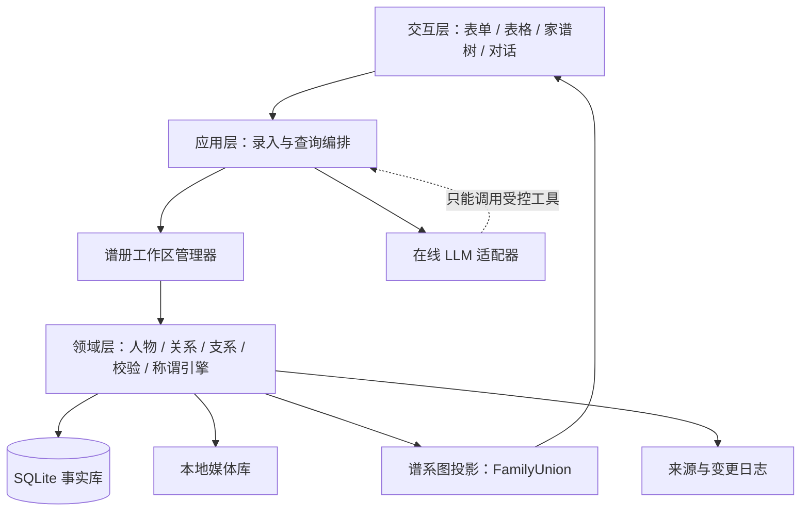

# LLM-Wiki 家谱智能体：产品设计与产品规划

版本：产品设计基线 v1.5  
日期：2026-09-16  
状态：最终产品规格已确认，可进入实施计划与开发阶段

## 1. 产品定义

这是一个本地优先的家谱知识库与对话智能体。系统以人物和关系构成的结构化事实图谱为核心，以 Wiki 内容承载人物生平、家族故事和多媒体资料，以大语言模型完成自然语言理解和表达。

产品遵循三条基本原则：

1. 数据库保存事实，规则引擎推导关系，LLM 负责理解和表达。
2. 任何 AI 生成的新增或修改事实，必须先形成草稿并由用户确认。
3. 关系计算必须给出可检查的路径；资料不足时明确说明，不猜测称谓。

首版面向一位家谱管理员，在一台电脑上维护多个彼此隔离的本地谱册工作区，每次只打开一个谱册。每个谱册预计包含约 100–1000 人。数据与媒体保存在本地；对话功能可以使用在线模型，不要求断网可用。

## 2. 三种“原点”的区分

系统明确区分以下三个概念，避免把视角和事实混在一起：

- 录入原点：首次创建谱册时选择的人，作为该谱册的引导录入和默认打开位置，可以随时更换。
- 当前视角：用户当前以谁的身份查看家谱，只影响称谓和界面呈现，不改变任何事实。
- 支系始祖：某个支系计算“第几代”的起点。世代编号属于支系语境，不是人物的全局属性。

## 3. 产品目标与首版边界

### 3.1 首版目标

- 通过表单、Excel/CSV 和自然语言对话建立可靠的家族事实库。
- 清晰展示父母、兄弟姐妹、配偶和子女，并支持全谱、分支、祖先和后代视图。
- 选择任意人物作为当前视角，计算他与其他人的双向称谓。
- 回答人物属性、家庭成员数量、关系路径和支系概况等问题。
- 保存照片、声音、人物生平和家族故事。
- 提供查重、冲突提示、变更记录、撤销、备份和恢复。
- 创建、切换和独立备份多个本地谱册工作区。

### 3.2 首版支持的关系

- 亲生父亲、亲生母亲与子女。
- 婚姻、离婚和再婚。
- 由上述事实推导出的祖孙、兄弟姐妹、叔伯姑舅姨、堂表亲、姻亲等通用普通话称谓。

### 3.3 首版不包含

- 多人实时协作、账号体系和云同步。
- 收养、继亲等复杂亲子关系。
- 地区方言称谓规则包。
- 按任意历史日期重新计算当时的亲属称谓。
- 自动公开发布家谱网站。
- 完全离线的大语言模型。
- 应用密码、本地数据库加密和加密备份。
- 未经确认的 AI 自动写库。

## 4. 核心使用流程

### 4.1 结构化录入

用户创建或编辑人物，填写姓名、别名、性别、出生和去世信息、字辈、支系以及备注；随后通过“添加父母、配偶、子女”建立关系。照片和音频从本地选择并复制到受管理的媒体库。

提交前执行关系一致性检查。通过后以单次事务保存事实、来源和变更记录；失败时不产生部分写入。

### 4.2 表格批量录入

系统提供标准模板，至少包含“人物”“亲子关系”“婚姻”三个工作表或等价 CSV 文件。人物表必须包含来源内唯一的 `person_external_id`，关系表只能通过该 ID 引用人物，不允许仅凭姓名连接。导入流程为：

1. 解析表头和字段映射。
2. 生成待导入人物和关系的预览。
3. 检测同名、疑似重复、缺失引用、环路和日期异常。
4. 用户修正、排除问题行或确认。
5. 将用户选定的有效变更以单次事务提交，并生成导入报告和可撤销操作组。

首次导入时，用户为数据源指定稳定的“来源键”；来源键不依赖文件名或文件路径。系统保存“谱册 + 来源键 + 外部 ID → 本地人物 ID”的映射。同一来源再次导入相同外部 ID 时生成更新差异，不重复创建人物，从而支持幂等重导入。系统不根据姓名自动合并人物；人物合并必须由用户确认。

### 4.3 对话式录入

用户可以输入“张国强有两个孩子，女儿张敏生于 1988 年，儿子张伟生于 1990 年”等描述。LLM 只负责抽取候选人物、属性和关系，输出结构化草稿。系统随后进行实体消歧和关系校验，并展示新增、修改及冲突的差异预览。用户确认后才写入数据库。

低置信度字段、重名人物和无法唯一定位的亲属必须停留在草稿中，不允许模型自行选择。

### 4.4 家谱浏览与视角切换

家谱在数据意义上是一个图，而非严格的树。界面可以继续使用用户熟悉的“家谱树”名称，但布局引擎必须支持离婚和再婚产生的多段家庭关系。家谱提供以下视图：

- 全谱视图：显示主要支系和各代分布，默认折叠远离当前视角的分支。
- 分支视图：以某位祖先或支系为根展示后代。
- 祖先视图：显示选定人物的父系、母系祖先。
- 后代视图：显示选定人物的子女及后续世代。

人物卡片显示姓名、照片、出生/去世年份、支系世代以及相对于当前视角的称谓。可视化层为每段婚姻派生一个“家庭联合节点”，把该段婚姻与父母双方均已确认的子女组织成一个家庭组。两位已知父母没有婚姻记录时，生成无婚姻状态的双亲家庭组；只有一位已知父母时，生成单亲家庭组，不根据该父母的配偶自动猜测另一位父母。同一人物始终引用同一个 Person 记录，不因再婚复制人物数据。婚姻使用横向连接，亲子使用纵向连接；已结束婚姻使用不同线型并显示结束原因和日期。

切换当前视角后，树结构中的事实不变，仅重新计算和显示称谓。

### 4.5 对话查询

首版支持四类问题：

- 属性查询：“张敏哪年出生？”
- 集合与统计：“张国强有几个孩子？”
- 关系查询：“张敏和张伟是什么关系？”
- 支系查询：“第六代有哪些人？”

回答包含结论、命中的人物以及必要的关系路径。叙事类问题从 Wiki 条目和来源中检索；没有来源时明确说明没有记录。

## 5. 信息架构与主要界面

桌面应用包含六个一级区域：

1. 首页：本地谱册列表、最近打开记录、新建/导入谱册和各谱册备份状态。
2. 家谱树：全谱/分支/祖先/后代切换、搜索、当前视角选择和关系高亮。
3. 人物库：人物列表、筛选、重复检测、人物合并、合并历史与反合并入口。
4. 录入中心：表单录入、表格导入、对话录入及导入报告。
5. 家族 Wiki：人物生平、家族故事、事件和录音转写。
6. 设置与数据：支系、称谓规则版本、模型连接、导出、备份与恢复。

对话面板可以从家谱树和人物详情中打开，并自动携带当前视角和当前选中人物，但不得绕过确认流程直接修改事实。

## 6. 领域数据模型

### 6.1 核心实体

| 实体 | 主要内容 | 设计说明 |
|---|---|---|
| GenealogyWorkspace | 谱册 ID、名称、录入原点、最近打开时间、数据模式版本 | 每个谱册拥有独立数据库、媒体目录和备份，不允许跨谱册关系 |
| Person | 全局稳定 ID、所属谱册、姓名、性别、出生/去世日期、历法与精度、备注 | 父母和子女不作为字段存储，统一通过关系表连接 |
| PersonAlias | 别名、乳名、曾用名、称呼 | 用于搜索与实体消歧，不替代正式姓名 |
| Lineage | 支系名称、支系始祖、说明 | 一个谱册可以包含多个支系 |
| LineageMembership | 人物、支系、归属角色、是否主要展示、申报世代、字辈标记 | 一人可属于多个支系；归属角色包括血缘成员、婚入成员和关联成员 |
| ParentChild | 父/母人物、子女人物、角色、来源 | 首版关系类型固定为亲生；为未来扩展保留类型字段 |
| Marriage | 两位配偶、开始/结束日期及精度、状态 | 离婚结束旧婚姻；再婚创建新的婚姻记录 |
| ImportIdentity | 谱册、导入来源键、外部人物 ID、本地人物 ID | 唯一键为“谱册 + 来源键 + 外部 ID”，保证关系引用可靠并支持幂等重导入 |
| MergeRecord | 主人物、被合并人物、迁移内容、操作组、状态 | 合并后保留旧 ID 重定向；允许在无后续冲突时反合并 |
| MediaAsset | 文件类型、哈希、相对路径、说明、关联人物 | 原文件复制到本地媒体库，避免外部路径失效 |
| WikiEntry | 标题、正文、关联人物/事件、更新时间 | 自由文本不直接作为亲属计算事实 |
| Source | 来源类型、原始位置、录入方式、可信度 | 来源包括表单、表格行、对话片段和人工修订 |
| AuditLog | 操作类型、修改前后内容、时间、操作组 | 支持查看历史、批量撤销和问题追踪 |

### 6.2 日期与缺失信息

首版对生日、去世、结婚和离婚日期采用单值模型，由管理员人工判断并录入当前采用值，不保存多个并行的事实说法。每个日期字段可以为空；一旦填写，必须选择农历或公历，并填写年、月，日为可选项。农历日期额外支持闰月标记。

数据库保存管理员输入的原始历法、年、月、可选日和日期精度。日为空时，精度为“月”；日存在时，精度为“日”。系统可以为排序、年龄判断和检索生成内部标准日期或日期范围，但界面默认显示用户录入的原始历法值；无法可靠换算时保持未知，不推测具体公历日期。

管理员修改日期时，新的单值成为当前采用值；旧值只保留在 AuditLog 中用于追溯和撤销，不作为并行事实参与称谓计算。

性别允许“男、女、未知”。称谓规则所需的性别或长幼信息缺失时，系统返回中性或并列表述，例如“堂姐或堂妹（长幼待确认）”。

### 6.3 支系与世代规则

- 一个人可以同时拥有多个 LineageMembership，例如在出生支系中是血缘成员、在配偶支系中是婚入成员。
- 每个人在一个谱册内最多选择一个“主要展示归属”；未选择时由当前视图决定展示哪个归属。
- 血缘成员可以依据支系始祖和亲子关系计算世代；婚入成员只在布局上与配偶处于同一代，不自动计入该支系的血缘世代统计；关联成员不自动计算世代。
- 申报世代是家族资料中的历史主张，原值不得被计算结果自动覆盖。
- 推导世代以该支系始祖为第 1 代，仅沿支系认可的亲生亲子关系计算。
- 申报世代与推导世代一致时显示统一结果；只有申报值时显示申报值；只有推导值时显示“系统推导”；两者冲突时优先展示申报值并附冲突标记，等待管理员处理。
- 字辈属于具体 LineageMembership；同一个人在不同支系中可以有不同字辈记录。

### 6.4 事实约束

- 禁止不同谱册之间建立人物、关系、支系或媒体引用。
- 禁止人物与自己建立亲子或婚姻关系。
- 亲子关系不得形成环路。
- 每个人最多有一位亲生父亲和一位亲生母亲。
- 首版每个人同一时间最多有一段有效婚姻；新的有效婚姻要求旧婚姻已结束。
- 出生、婚姻和亲子年龄异常默认提示并要求确认；只有逻辑不可能的关系才阻止提交。
- 核心关系均关联来源与变更记录。
- 核心事实使用软删除，以便恢复和审计。

“一家人”的核心家庭不作为权威事实重复维护。可视化层依据婚姻和亲子事实动态生成 FamilyUnion；宗族或支系归属使用 LineageMembership 表达。

FamilyUnion 不写入权威事实表。存在婚姻时使用婚姻 ID 生成稳定投影 ID；没有婚姻但两位父母均已确认时，使用排序后的父母 ID 组合生成；只有一位已知父母时生成单亲投影。补充父母或婚姻事实后重新计算投影，但不改变 Person ID。

### 6.5 人物合并与反合并

合并前必须展示两个人物的属性、别名、父母、配偶、子女、支系、媒体和来源差异。用户选定主人物及冲突字段后，系统在一个操作组内迁移所有引用，并把被合并 ID 保存为 ID 重定向映射。

合并操作不得物理删除原记录。只要合并后没有产生无法拆分的人工修改，用户可以执行反合并，恢复原人物及其关系、媒体和来源；不能安全反合并时，系统展示阻塞原因和受影响记录，不执行部分恢复。

## 7. 称谓与关系推理引擎

### 7.1 推理步骤

1. 将问题中的姓名解析为唯一人物 ID；存在重名时要求用户选择。
2. 在有效亲子和婚姻关系中搜索候选路径，并保留同等级的多条路径。
3. 将每条原始路径归一化为标准称谓签名。
4. 使用版本化规则表匹配普通话称谓，分别计算正向与反向结果。
5. 输出称谓、关系路径、采用的规则版本和必要的不确定性说明。

### 7.2 标准称谓签名

称谓引擎不直接用自然语言路径查表。每条候选路径必须转换为结构化 KinshipSignature，至少包含：

- `steps`：父、母、兄、弟、姐、妹、子、女、配偶等归一化步骤。
- `generation_delta`：目标人物相对于当前视角的代差。
- `lineage_side`：父系、母系、自身支系或姻亲侧。
- `blood_affinity`：纯血缘、当前婚姻姻亲或直接前配偶。
- `viewpoint_gender` 与 `target_gender`：视角和目标人物的已知性别。
- `relative_age_order`：涉及兄弟姐妹或堂表亲时的长幼状态，允许未知。
- `path_person_ids` 与 `path_relation_ids`：用于解释和审计的实际路径。

规则表使用“签名模式 → 正向称谓、反向称谓、适用条件”的形式，并带独立版本号。规则版本改变不会修改人物和关系事实。

### 7.3 规则匹配与路径排序

候选路径先按边数排序；边数相同时按“直接关系、纯血缘、当前婚姻”的顺序排序。同等级存在多条有效路径时，系统保留全部结果，展示一个主要称谓并提示其他关系路径，不静默丢弃。已结束婚姻不得作为中间边参与当前称谓路径搜索。

规则覆盖测试不能只以案例总数衡量。测试矩阵至少覆盖直系、祖孙、兄弟姐妹、父系旁系、母系旁系、堂表亲、当前姻亲、离婚、长幼未知、性别未知和多路径关系。Beta 阶段要求不少于 300 个黄金案例，并保证覆盖矩阵中的每个分类都有正向、反向和缺失信息测试。

### 7.4 离婚与再婚

- 离婚后，两人的直接称谓变为“前夫/前妻”。
- 已结束婚姻只允许识别婚姻两端的直接前配偶关系，不继续穿过该婚姻推导前姻亲。
- 人物详情可以查看婚姻的开始、结束和状态记录，但首版称谓引擎不接受历史时间点，也不重新计算“当时”的亲属称谓。
- 父母离婚或再婚不会改变亲生子女关系。

### 7.5 无法确定时的行为

- 年龄未知：返回并列称谓，不猜长幼。
- 规则未覆盖：返回准确的关系路径描述，并标记为规则待扩充。
- 数据冲突：停止推算并指向冲突记录。
- 无可达路径：说明当前家谱中没有足够关系数据。

称谓规则采用版本化规则表和确定性测试，不由 LLM 即兴生成。

## 8. 系统架构

### 8.1 交互层

负责人物和关系编辑、导入预览、家谱渲染、当前视角、对话以及冲突提示。界面只通过应用服务修改数据。

### 8.2 应用层

负责谱册切换、录入草稿、实体消歧、导入外部 ID 映射、人物合并/反合并、事务编排、查询工具、备份和导出。对 LLM 暴露有限且带类型约束的工具，不暴露原始数据库连接或任意 SQL。

建议的首版查询工具包括：

- `search_people`：按姓名、别名和基本信息查找候选人物。
- `get_person`：读取一个人物的结构化资料与来源。
- `list_relatives`：读取父母、配偶、子女或指定类型亲属。
- `calculate_relationship`：计算两人的双向称谓和路径。
- `summarize_lineage`：按支系、世代或分支生成结构化统计。
- `search_wiki`：从 Wiki 条目中检索带来源的叙事资料。

所有修改采用另一组草稿工具；最终提交必须由显式用户确认触发。

### 8.3 领域层

领域层是事实和规则的唯一权威入口，包含人物服务、关系服务、支系与世代服务、FamilyUnion 投影、称谓签名生成器、称谓规则匹配器和一致性校验器。该层可以脱离 UI 和 LLM 独立测试。

### 8.4 基础设施层

- 应用索引只保存谱册清单、目录位置和最近打开信息，不保存跨谱册人物关系。
- 每个谱册使用独立 SQLite 文件保存结构化事实、全文索引、外部 ID 映射、合并记录、来源和审计记录。
- 每个谱册拥有独立媒体目录；媒体使用内容哈希命名，数据库保存相对路径和元数据。
- 模型适配器允许替换不同在线 LLM，并限制发送的上下文。
- 备份包包含数据库、媒体、清单、版本和校验哈希。

## 9. LLM-Wiki 的职责边界

LLM-Wiki 分为两层：

- 事实层：人物、关系、日期、支系、来源和媒体元数据，适合精确查询和推理。
- 叙事层：人物生平、家族故事、事件记录和录音转写，适合全文检索和内容问答。

首版对事实问题优先使用结构化查询，对叙事问题使用 SQLite 全文检索并返回来源。首版不引入独立向量数据库；语义向量检索作为首版后增强，避免在核心闭环验证前增加基础设施。

LLM 不得承担以下职责：

- 自行决定重名人物的身份。
- 直接写数据库或绕过领域校验。
- 在缺少性别、年龄或关系时编造称谓。
- 将 Wiki 自由文本自动提升为已确认事实。

## 10. 本地数据、隐私与恢复

- 数据库、媒体和导入文件默认保存在应用专属本地目录。
- 首版依赖 Windows 用户账户和应用目录权限保护本地文件，不增加应用密码或数据库加密。
- 在线模型只接收回答当前问题或解析当前输入所需的最少上下文。
- 发送前在界面中显示“将调用在线模型”，并允许用户取消。
- 模型密钥保存在操作系统凭据存储中，不写入数据库、日志或备份。
- 日志不得记录完整媒体内容、密钥或无关家族资料。
- 备份与恢复都执行清单和哈希校验；恢复前自动创建当前数据快照。
- 首版备份包不加密。创建和导出时明确提示其包含家族隐私数据，建议保存在受系统权限或磁盘加密保护的位置。

## 11. 推荐实施基线

为了满足 AI 主导的快速交付目标，首版推荐使用：

- Windows 优先的 Electron 桌面应用。
- React + TypeScript 构建界面和领域服务。
- SQLite + `better-sqlite3` 保存本地数据，并使用版本化迁移。
- Electron 主进程通过带类型约束的 IPC 提供数据与文件操作，渲染进程不直接访问数据库。
- Electron 必须启用上下文隔离和渲染进程沙箱、关闭渲染进程 Node.js 集成、使用严格内容安全策略，并通过预加载层只暴露白名单 IPC。在线模型请求和文件访问只能在主进程执行。
- 应用索引管理多个谱册目录；每个谱册目录包含独立数据库、媒体目录、清单和备份元数据。
- 家谱布局使用分层图布局算法，以派生 FamilyUnion 组织婚姻和子女，视图采用 SVG 或 Canvas，并对折叠分支做增量渲染。
- 称谓引擎使用 TypeScript 纯函数、KinshipSignature 和版本化规则表，便于覆盖矩阵和批量回归测试。

技术结构保持模块化，后续可以替换桌面壳、模型供应商或可视化实现，而不修改领域数据格式。

## 12. AI 主导的实施路线图

时间以连续智能体工作小时估算。前提是需求稳定、Token 不限、依赖安装正常，且关键界面能够及时获得用户反馈。等待确认、下载、编译和人工验收仍占用真实日历时间。

正常条件下，可交付 Beta 的目标为 **24–40 个智能体工作小时、3–5 个日历日**。项目另设 **最多 60 个智能体工作小时、7 个日历日**的风险缓冲，用于依赖或打包兼容问题、称谓回归失败、1000 人性能优化以及关键界面反馈所引发的必要返工。风险缓冲不是计划工期，也不用于增加首版功能；如果预计超过该上限，必须先说明阻塞原因或范围变化并重新确认，不静默延长。

### 阶段 1：纵向可运行骨架（0–6 小时，第 1 天）

- 建立桌面应用、SQLite 和数据库迁移。
- 完成谱册工作区、人物、支系归属、亲子、婚姻及离婚/再婚模型。
- 完成农历/公历日期、年月精度和可选日期输入。
- 完成基础增删改查和 20 人样例家谱。

出口标准：能够录入并重新打开一个完整家庭。

### 阶段 2：录入与事实治理（6–14 小时，第 1–2 天）

- 完成人物/关系表单和 Excel/CSV 导入预览。
- 完成外部 ID 映射、幂等重导入、对话解析草稿、实体消歧与冲突检测。
- 完成可预览、可撤销的人物合并与反合并。
- 加入媒体、来源、审计、撤销和备份。

出口标准：所有 AI 修改均经过确认；批量导入失败不会产生部分写入。

### 阶段 3：核心 MVP（14–24 小时，第 2–3 天）

- 完成基于 FamilyUnion 的全谱、分支、祖先和后代视图。
- 完成当前视角切换、称谓签名、路径搜索和双向称谓。
- 完成结构化事实问答及依据展示。

出口标准：录入、浏览、关系推理和问答形成完整闭环，可开始使用真实家族数据。

### 阶段 4：可交付 Beta（24–40 小时，第 3–5 天）

- 建立并跑通 300 个称谓回归案例。
- 完成 1000 人数据集的性能测试和优化。
- 完成备份恢复演练、安装包、错误处理和界面打磨。

出口标准：满足第 13 节全部验收条件。

## 13. MVP 验收标准

### 13.1 正确性

- 300 个已定义的普通话亲属称谓案例全部通过。
- 每个关系答案都可以展示实际采用的人物与关系路径。
- 信息不足、重名、冲突和规则未覆盖时不得输出伪确定答案。

### 13.2 数据可靠性

- 自动阻止自关联、亲子环路和超过父母数量约束的写入。
- 自动阻止跨谱册引用；不同谱册的数据库和媒体备份互不混入。
- 单次表单、对话确认和批量导入均为原子事务。
- 同一来源、同一外部 ID 的文件重复导入不会生成重复人物，并能展示更新差异。
- 人物合并能够迁移全部引用并保留旧 ID 映射；满足安全条件时可以完整反合并。
- 日期填写后必须包含历法、年和月，日可以为空；农历闰月能够明确保存，日期修改可通过审计记录追溯和撤销。
- 备份恢复后，人物、关系、Wiki、审计和媒体文件数量一致，哈希校验全部通过。
- 每项事实可以追溯到来源和最近一次修改。

### 13.3 支系、视图与称谓

- 同一人物可以拥有多个支系归属，每个归属的角色、字辈和世代互不覆盖。
- 申报世代与推导世代冲突时保留申报值、显示冲突，不自动改写历史资料。
- 再婚人物在数据库中只有一个 Person 记录；FamilyUnion 能把不同婚姻的子女放入正确家庭组。
- 每个称谓结果包含 KinshipSignature、正向/反向称谓、规则版本和实际人物路径。
- 称谓引擎只计算当前关系；已结束婚姻不会被用作中间路径，但婚姻两端仍可识别为前夫/前妻。
- 不少于 300 个黄金案例全部通过，并覆盖既定测试矩阵的所有分类。

### 13.4 性能

基准环境为普通 Windows 11 电脑，至少 4 核 CPU、8 GB 内存，测试家谱包含 1000 人和对应关系：

- 首次呈现默认家谱视图不超过 2 秒。
- 初次呈现后切换当前视角不超过 500 毫秒。
- 不包含网络和 LLM 响应时间的纯关系计算，P95 不超过 300 毫秒。
- 1000 行标准数据的导入预检不超过 30 秒。

### 13.5 智能体可信度

- LLM 没有原始数据库或任意 SQL 权限。
- 每次修改先展示结构化草稿和差异。
- 回答优先引用结构化事实；叙事回答展示 Wiki 来源。
- 模型服务不可用时，表单、表格、家谱浏览和确定性称谓查询仍可使用。

### 13.6 本地安全

- 渲染进程无法直接使用 Node.js、SQLite、任意文件路径或模型密钥。
- 预加载层只暴露规格中定义的白名单 IPC；非法参数和越权谱册路径被主进程拒绝。
- 内容安全策略阻止未批准的远程脚本、页面跳转和内联执行。
- 模型密钥不会出现在数据库、日志、崩溃报告或备份包中。
- 创建未加密备份或导出文件时，界面必须明确提示隐私风险；首版不宣称提供静态数据加密。

### 13.7 易用性

没有技术背景的试用者在不阅读说明的情况下，可以在 10 分钟内完成一个 5 人家庭的录入、一次纠错、一次视角切换和一次关系查询。

## 14. 主要风险与控制措施

| 风险 | 控制措施 |
|---|---|
| 中文亲属称谓组合复杂 | 采用版本化规则表、路径依据和 300 个黄金回归案例 |
| 同名与口述信息模糊 | 使用稳定人物 ID、候选人选择和确认草稿，不按姓名自动合并 |
| 再婚使家谱不再是严格树结构 | 使用派生 FamilyUnion 组织每段婚姻及对应子女，不复制人物事实 |
| 支系世代资料与系统推导冲突 | 保留申报值、单独计算推导值并显示冲突，不自动覆盖 |
| 1000 人全谱过度拥挤 | 默认聚焦当前视角、折叠远端分支，并提供分支/祖先/后代视图 |
| LLM 产生错误事实 | 限制为抽取和表达，写入前经过领域校验与人工确认 |
| 在线模型泄露隐私 | 本地保存完整数据，只发送完成当前任务所需的最少上下文 |
| 同一 Windows 账户下的其他程序读取本地文件 | 使用应用目录权限和 Electron 进程隔离；界面明确说明首版不提供数据库或备份加密 |
| 重复导入和人物合并破坏引用 | 使用来源内外部 ID、幂等更新、合并预览、旧 ID 映射和反合并 |
| 导入错误破坏数据库 | 分阶段预检、问题行排除、原子事务、操作组撤销和导入前快照 |
| 备份缺少媒体或版本不兼容 | 备份清单、哈希校验、版本化迁移和恢复前快照 |

## 15. 首版后的演进顺序

1. 录音自动转写、人物时间线和家族故事编辑体验。
2. 打印版、PDF 导出和更丰富的姻亲称谓。
3. Wiki 语义检索和可替换的本地模型。
4. 收养、继亲及其他复杂关系。
5. 方言称谓规则包。
6. 多人协作、云同步和权限体系。

首版成功的判断不是功能数量，而是三个闭环同时可靠：能够快速录入事实、能够清楚浏览关系、能够给出可解释且不乱猜的称谓和答案。

## 16. 第二轮设计优化记录

本版本已经纳入以下确认项：

1. 以 FamilyUnion 投影处理离婚和再婚形成的图结构。
2. 支持人物多重支系归属及归属角色。
3. 明确申报世代与系统推导世代的展示和冲突规则。
4. 使用 KinshipSignature 和覆盖矩阵形式化称谓规则。
5. 表格使用来源内外部 ID，并支持幂等重导入。
6. 人物合并保留旧 ID 映射，并在安全条件下支持反合并。
7. 支持多个彼此隔离的本地谱册工作区。
8. 首版日期采用管理员确认的单值模型，支持农历/公历、年和月必填、日可选及农历闰月。
9. 首版不支持按历史时间点重算称谓；已结束婚姻仅保留直接前配偶关系和婚姻记录。
10. 首版采用轻量本地安全方案：强制 Electron 隔离和系统凭据存储，但不增加应用密码、数据库加密或加密备份。
11. 可交付 Beta 的正常目标为 24–40 个智能体工作小时、3–5 个日历日；为已识别的工程风险预留最多 60 个工作小时、7 个日历日的上限，缓冲不扩展首版范围。

通用事实声明层、按历史时间点查询和本地数据加密明确不进入首版。日期历史仅通过审计记录保留。第二轮 P0 优化项已全部形成明确决策，未扩展首版产品范围。
